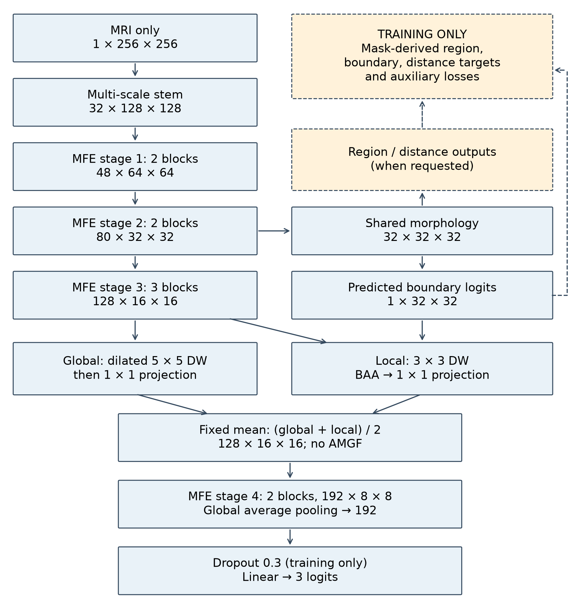

# MorphoNet-BT: A Lightweight Morphology-Supervised Dual-Path Network for Brain Tumor Classification in Contrast-Enhanced MRI

MorphoNet-BT studies MRI-only brain tumor classification with morphology supervision during training. The principal **A4** network integrates predicted-boundary guidance with global/local convolutional features. This is a release staging package for author-managed publication; the associated manuscript is **unpublished**. No trained weights are distributed.

## Principal A4 architecture

MSS and MFE features feed region/boundary/distance auxiliary predictors and predicted-boundary-guided BAA. Global and local paths use **fixed arithmetic mean fusion**. **No AMGF in A4**; historical A5 retains AMGF. Boundary prediction remains active for classification inference, while other auxiliary outputs can be skipped. The classifier accepts MRI alone; masks serve training supervision/augmentation and offline reference diagnostics.

## Architecture figure



## Key contributions

- Compact integrated morphology-supervised architecture with explicit inference computation scope.
- Patient-disjoint comparison with five internally trained baselines and cumulative A0-A5 ablations.
- Archived paired statistical analyses and qualified spatial/occlusion diagnostics.

See [architecture](docs/architecture.md) and the [A4 configuration](configs/morphonet_bt_a4.yaml). The A4 YAML is documentation, not a standalone execution loader; configs/default.yaml remains historical A5.

## Dataset information

The study uses **3,064 CE-MRI slices from 233 patients**, with meningioma, glioma and pituitary classes. MRI is resized to 256 by 256 and standardized using per-image all-pixel Z-score normalization without clipping. Validation and Test preprocessing are deterministic; frozen training augmentation and mask-target definitions are documented in [the scientific protocol](docs/scientific_protocol.md). Obtain source data from the original provider using [dataset setup](docs/dataset_setup.md); no MRI or patient-linked records are included.

## Experimental methodology

Five patient-disjoint outer folds use frozen patient grouping and seed 42, with an inner training/validation split. Checkpoint selection uses validation macro-F1. Five internal baselines were trained from scratch; A0-A5 are cumulative ablations. Patient predictions average slice class probabilities before argmax. A4 was selected after inspecting outer-held-out results, so comparisons are exploratory and may be optimistic. These internal comparisons are distinct from independently published studies.

## Main results

The cohort contains 3,064 slices from 233 patients, with five patient-disjoint outer folds. Patient predictions average per-slice class probabilities within each patient before argmax. These are archived pooled out-of-fold results, not new measurements.

| Level | Accuracy | Macro-F1 | Macro ROC-AUC |
|---|---:|---:|---:|
| Slice | 92.5914% | 91.5452% | 98.3899% |
| Patient | 95.2790% | 95.3466% | 98.7162% |

**Interpretation:** A4 was selected post hoc after examining outer-held-out results; estimates are exploratory. A5 had higher validation performance. Patient-correctness comparisons with A5 and DenseNet121 are not Holm-significant; only ResNet50 and MobileNetV3-Small comparisons survive the primary correction. Cumulative ablations do not isolate causal component effects. Internal from-scratch baselines are distinct from independently published studies. No clinical readiness, independent confirmation or universal SOTA superiority is claimed.

## Computational complexity

A4 has **575,359 parameters**, **275,711,872 Conv/Linear MACs**, **2.301436 decimal MB FP32 parameter storage**, and **551,423,744 FLOPs** under the convention 1 MAC = 2 FLOPs. Parameters include auxiliary predictors; MACs omit inactive auxiliary computation and non-Conv/Linear operations. MobileNetV3-Small has fewer MACs; no universal efficiency or matched-device latency advantage is claimed.

## Repository structure

| Directory | Retained contents |
|---|---|
| src/ | Scientific src.* implementation, training, evaluation and analysis |
| configs/ | Principal A4 manifest and required shared/A5/baseline/ablation settings |
| notebooks/ | 17 canonical workflows; A5 comparator stages are explicitly labeled |
| results/ | 21 final aggregate CSVs and verified A4 PNG/PDF |
| docs/ | Architecture, protocol, setup, artifact access and licensing |
| scripts/ | CSV viewer, static validator and required Notebook 06 subprocess helper |
| tests/ | Static tests and minimal scientific/license integrity fixtures |
| .github/ | Issue and contribution templates |

## Installation

Create a separate Python environment and install `requirements-static.txt` for inspection. The research requirements.txt and environment.yml are preserved observations, not a verified cross-platform research lock. See [installation](docs/installation.md) and [compatibility](docs/environment_compatibility.md).

## Quick Start

A verified repository URL has not been supplied. Extract the supplied release ZIP, or use the authors' verified repository URL when available, and enter its repository root. The commands below operate only on included files:

```shell
python -m venv .venv-static
```

Activate the new environment using the platform instructions in [installation](docs/installation.md), then:

```shell
python -m pip install -r requirements-static.txt
python scripts/show_results.py
python scripts/validate_release.py
```

`show_results.py` uses only Python's standard library and reads aggregate CSVs without writing files. It can run before dependency installation. Read [the A4 configuration](configs/morphonet_bt_a4.yaml) and [architecture](docs/architecture.md) directly. The YAML is a documentation manifest, not a new loader or training command. The existing implementation uses `src.models.ablation.build_ablation("A4")`; this is an API reference, not a pretrained inference demonstration. **configs/default.yaml remains historical A5.**

Research pins are preserved in [requirements.txt](requirements.txt). They are not a verified portable installation lock. See [environment compatibility](docs/environment_compatibility.md).

## Reproducibility notes

The included aggregates are inspectable now. MRI, canonical private splits, checkpoints, sample-level predictions and original runtime-integrity records are not distributed. Statistics, inference and retraining have different missing prerequisites. See [reproducibility](docs/reproducibility.md), [artifact availability](docs/artifact_availability.md) and the [notebook guide](notebooks/README.md). Full end-to-end reproducibility is not claimed. Notebook gates remain disabled.

## Ablation and baseline experiments

The principal A4 route is defined through notebooks 11-13 and src.models.ablation. Baselines use 08-10; statistics use 14. Original A5 notebooks 04-07 are retained because their architecture/fingerprint/checkpoint chain supports the reused A5 comparator. They are not relabeled as A4. Notebook 06 invokes scripts/phase6_smoke.py; this required experimental helper is not a static Quick Start command. Snapshots and historical diagnostic exports have been excluded; final A5/baseline/ablation results remain in results/tables.

## Limitations

Single-cohort evaluation, post hoc architecture selection, shared training patients across folds and absent external validation limit generalization. Bootstrap intervals condition on saved predictions and omit retraining and selection uncertainty. Morphological and occlusion analyses are sensitivity evidence, not causal localization. Private paths and historical source fingerprints prevent a one-command replay of frozen experiments. Static validation does not establish experimental reproducibility.

## Citation

Use [CITATION.cff](CITATION.cff) or this provisional unpublished citation. No publication year, DOI, release tag or repository URL has been verified.

```bibtex
@unpublished{aswad_morphonet_bt,
  author = {Aswad, Salma and Ozturk, Serkan},
  title = {MorphoNet-BT: A Lightweight Morphology-Supervised Dual-Path Network for Brain Tumor Classification in Contrast-Enhanced MRI},
  note = {Unpublished manuscript and software release candidate}
}
```

## Authors

1. **Salma Aswad** — student, first and corresponding author; salma.abdullah@uod.ac; [ORCID 0009-0007-2906-2001](https://orcid.org/0009-0007-2906-2001).
2. **Serkan Ozturk** — advisor, second author; Serkan@ergiyes.edu.tr.

Salma Aswad: **affiliations 1 and 2**. Serkan Ozturk: **affiliation 1 only**.

1. Computer Engineering, Erciyes University, Kayseri, Turkey
2. Department of Computer Science, College of Science, University of Duhok, Duhok 42001, Iraq

## License

Original project code and eligible original repository materials are provided under the [MIT License](LICENSE), copyright (c) 2026 Salma Aswad and Serkan Ozturk. External dependencies and the Cheng/Figshare MRI dataset retain their own terms and are not automatically covered by this MIT grant. See [licensing and attribution](docs/licensing_decisions.md) and [dependency licenses](docs/third_party_licenses.md).
